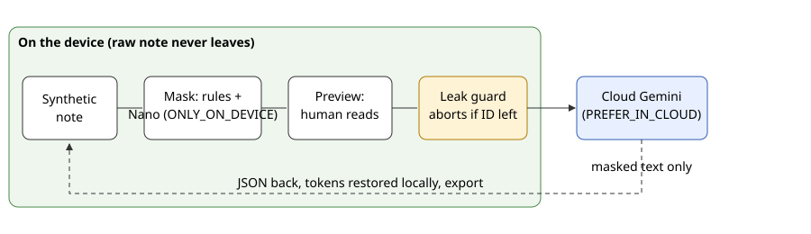

# Private Clinical Registry Gate



**Try it:** https://registry-gate-hybrid26.web.app (no login, no keys) · **Run it:** `npm ci && npm run dev`

**A registry abstractor can send a kidney-clinic note to a cloud Gemini model with identifiers masked on the device first, and see exactly what leaves.** Identifiers are masked locally first (rules plus an on-device model through Firebase AI Logic); the masked text is previewed; the cloud call is aborted if any identifier is still in it.

Entry for **#BuildHybridAI 2026** (Firebase AI Logic hybrid inference, Devpost). Synthetic notes and open-access abstracts only. Not a de-identification tool, not validated for clinical use.

**Headline — real published prose (50 open-access PMC nephrology texts, `data/pmc/pmc50.json`, synthetic surrogate identifiers):** allowing `'not documented'` in the cloud schema (`gemini-3.5-flash-lite` via Firebase AI Logic, oracle name masking, `docs/cloud-eval-pmc-v2.json`) cut invented eGFR numbers from 10 to **0** (previously 20/50 matched an unreliable automatic key under forced-number output). Every text was re-read for "the most recent single patient eGFR" (27 document a patient value, 23 document none): scored against that audited key, the recorded run is **46 of 50 correct (92.0%)** — 24 of 27 patient values returned and 22 of 23 no-value texts answered `'not documented'` (misses: `pmc-02`, `pmc-04`, `pmc-37` missed; `pmc-07` cohort median returned). Single AI reader, no clinician adjudication, one run (`docs/pmc50-key-audit.json`; reproduce zero-cloud audit with `node scripts/audit-pmc-key.mjs`). Rules-only guard on PMC50 (`npm run bench:pmc`, mock cloud): masker hid 300 of 350 synthetic identifiers; all 50 notes blocked on free-prose relative names; 0 leaked (`docs/bench-pmc-real-prose.json`).

**Independent held-out hand-written notes** (24 original notes in `data/heldout/handwritten_notes.json`, zero name overlap with `scripts/gen-cases.mjs`, rules-only, `npm run bench:heldout`, mock cloud): the masker hid **156 of 177** seeded identifiers (**88.1%**); all 21 misses are names (20 prose names plus `Mateo` in `Alvarez, Mateo`; 0 MRN, date, phone or email misses), so the guard blocked 20 notes, sent 4, and **0** of 177 identifiers reached the cloud (`docs/bench-heldout-rules-only.json`).

**Measured with Gemini Nano plus the real cloud model** (3 repeat in-app 20-note runs, 25 Nov 2026, desktop Chrome where `LanguageModel.availability()` was `available`, against deployed Firebase AI Logic `gemini-3.5-flash-lite`; `docs/bench-nano-runs.json`): every run masked 154 of 154 seeded identifiers, sent 20 of 20 notes, blocked 0 and had 0 leaked payloads, with identical stage, eGFR and albuminuria outputs across all 3 runs. Not repeatable in CI, model output can vary, and Nano can mask ordinary words as names (on 19 Nov 2026 it masked e.g. "Family"). Synthetic seeded notes only.

**What Google's own logs saw** (Firebase AI monitoring on, one live request from the deployed app, 22 Nov 2026): the request Firebase AI Logic logged in Cloud Logging held only placeholders (`[NAME_1]`, `[MRN_1]`, `[DATE_1]`...); 0 of the 143 seeded identifiers of the 20 synthetic cases appeared in the logs (`docs/ai-monitoring-log-check.json`). Reads Google's side, independent of our guard; one request only.

**Synthetic seeded runs (guard & extraction baselines):**
- **Rules-only, 100 seeded synthetic notes** (`npm run bench:100`, 772 seeded identifiers, mock cloud, `docs/bench-100-rules-only.json`): masker hid **683 of 772** (89 misses all free-prose names); guard blocked 71 notes, sent 29, and **0** of 772 seeded identifiers reached the cloud (a guard property: it checks the same seeded list; 683/772 is the independent masking number). Earlier 20-note run: 137/154 masked, 14 blocked, 6 sent (`docs/bench-rules-only.json`).
- **Real cloud extraction, 100 seeded synthetic notes** (`gemini-3.5-flash-lite`, Sprint 2 project `fbailogic26vrt-3028`, seeded-name oracle masking, 3 runs, 22 Nov 2026, `docs/cloud-eval-100-runs.json`): eGFR 100/100 and albuminuria 100/100 in every run; model's own CKD stage 86, 85 and 83 of 100 (same 14 notes missed, one stage off); code-derived stage from eGFR 100/100 in every run (earlier 20-note run: 20/20 eGFR & UACR, 17/20 model stage, 20/20 code stage, `docs/cloud-eval.json`).

Details and non-claims: [docs/CLAIMS.md](docs/CLAIMS.md).

```bash
npm ci && npm run dev      # app at http://localhost:5173, runs with no keys
npm test                   # includes leak tests + 24 held-out hand-written note checks
npm run bench:100          # 100-case synthetic rules-only run (bench:pmc for PMC50, bench:heldout for 24 held-out notes)
```

## How it works
1. **Local guard:** rules for MRN, dates, phone, email and names after a title or label; Firebase AI Logic `ONLY_ON_DEVICE` (Gemini Nano) for names in prose. If Nano is unavailable the app says so, runs rules-only, and never falls back to the cloud with raw text.
2. **Preview and leak guard:** you see the masked text. `src/cloud/egress.js` scans the exact outgoing request and throws before the cloud call if one of the note's seeded identifiers or an identifier pattern remains. For a note you paste yourself there is no seeded list, so only patterns are checked, names in prose are not, and the app asks you to confirm after reading the masked text.
3. **Cloud call:** `PREFER_IN_CLOUD` on a free Gemini model returns JSON: CKD stage, eGFR, albuminuria category, evidence quote. Code checks the stage against the eGFR. The Egress Inspector shows the SDK's own `inferenceSource` for each step (`on_device` for name detection, `in_cloud` for extraction), so the hybrid routing is reported by Firebase, not assumed.
4. **Local rehydration and export:** tokens are restored from an in-memory vault; download JSON, CSV or a **FHIR R4** collection Bundle (`src/fhir.js`: Patient, eGFR and albuminuria Observations with LOINC codes, a CKD-stage Condition with a SNOMED CT code, built locally from the rehydrated result, surrogate identifiers only).
5. **KDIGO 2024 risk and nephrotoxin check:** `src/kdigo.js` places the eGFR stage (G1 to G5) and albuminuria category (A1 to A3) on the KDIGO 2024 risk matrix (heatmap tier: Low, Moderate, High, Very High) and flags NSAID mentions in the note as a nephrotoxin alert (keyword match on the raw note, local only; negations are not interpreted, so the abstractor reads the context). Literature behind the staging and the problem: [docs/EVIDENCE_LITERATURE.md](docs/EVIDENCE_LITERATURE.md).
6. **Hosting security headers:** `firebase.json` sets a Content-Security-Policy that restricts `script-src` (self plus Google and reCAPTCHA origins), `connect-src` (`'self'`, `https://*.googleapis.com` and the Google reCAPTCHA origins), `frame-src`, with `object-src 'none'` and `frame-ancestors 'none'`, plus companion headers (`X-Frame-Options: DENY`, `X-Content-Type-Options: nosniff`, `Referrer-Policy`, `Permissions-Policy`, `Cross-Origin-Opener-Policy`); the deployed headers can be read with `curl -sI https://registry-gate-hybrid26.web.app`.

## What is real and what is mocked in this repo
| Part | Without a Firebase config (default) | With config |
|---|---|---|
| On-device names | Real Firebase AI Logic call if Chrome offers Gemini Nano, otherwise rules-only | same |
| Cloud extraction | **MOCK** regex stand-in, labelled in the UI | Firebase AI Logic, `gemini-3.5-flash-lite` (live build: https://registry-gate-hybrid26.web.app) |
| App Check | off | reCAPTCHA Enterprise |

## Configure Firebase (owner's step)
Spark plan only. Copy `.env.example` to `.env.local`, fill the public web config and the reCAPTCHA Enterprise site key, `npm run build`, `firebase deploy --only hosting`. No debug token is stored in the code; in dev the SDK prints one to register in the console.

## Layout
`src/guard/` rules, masking, leak guard, Nano · `src/cloud/` the only cloud egress and the mock · `src/pipeline.js` shared pipeline · `src/kdigo.js` KDIGO 2024 staging, risk matrix, nephrotoxin check · `src/fhir.js` FHIR R4 Bundle export · `firebase.json` Hosting CSP and security headers · `data/pmc/` 50 PMC texts · `data/heldout/` 24 hand-written notes · `data/synthetic/` seeded notes · `scripts/` benches, cloud eval, `audit-pmc-key.mjs` · `docs/` [evidence literature](docs/EVIDENCE_LITERATURE.md), [PMC key audit](docs/pmc50-key-audit.json), [held-out bench](docs/bench-heldout-rules-only.json), [Nano 3x runs](docs/bench-nano-runs.json), [data card](docs/DATA_CARD.md), [claims](docs/CLAIMS.md), [judges](docs/JUDGES.md), [spec](docs/SPEC.md)

Licence: Apache-2.0.
